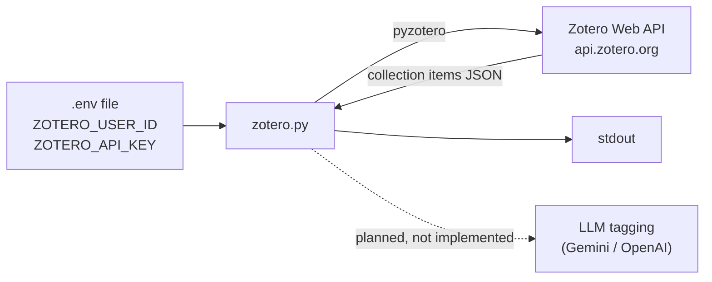

# zotero

A small Python script that reads items from a Zotero library through the Zotero Web API, using
[pyzotero](https://pyzotero.readthedocs.io/).

## Description

This repository was started in December 2023 as the seed of a tool to work with a personal Zotero library from Python,
with the longer-term idea of using an LLM to suggest tags for library items. Only the first step exists today: the
script authenticates against the Zotero Web API and prints the top-level items of one collection.

It is useful as a minimal, working example of connecting to Zotero with pyzotero and reading credentials from a
`.env` file. It is not a finished tool.

## Features

What the code actually does:

- Loads the Zotero user ID and API key from environment variables (via `python-dotenv`).
- `get_collection_items(collection_id)`: returns the top-level items of a collection
  (`zot.collection_items_top`).
- `get_all_items()`: returns every top-level item in the library, following pagination (`zot.everything(zot.top())`).
  Defined but not called.
- When run, fetches the items of one collection whose key is hardcoded in `zotero.py` and prints them.

Planned in the original README but **not implemented**: updating items and generating tags with AI/ML. The packages
for that (`google-generativeai`, `langchain-google-genai`, `openai`, `beautifulsoup4`) are listed in
`requirements.txt` and `GOOGLE_API_KEY` is read, but none of them are used yet.

## Architecture



## Requirements

- Python 3 (the pinned dependency versions date from late 2023; Python 3.10 or 3.11 is the safest choice).
- A Zotero account, its numeric user ID and an API key with read access
  (created at <https://www.zotero.org/settings/keys>).

## Installation and quick start

```bash
git clone https://github.com/Lapeyus/zotero.git
cd zotero
python3 -m venv .venv
source .venv/bin/activate
pip install -r requirements.txt

cat > .env <<'EOF'
ZOTERO_USER_ID=
ZOTERO_API_KEY=
EOF
# fill in the values, then edit the collection key in zotero.py (see Usage)

python zotero.py
```

## Usage

The script has no command-line arguments. To read a different collection, change the key passed to
`get_collection_items(...)` near the bottom of `zotero.py`. A collection key is the 8-character ID visible in the
collection's URL on zotero.org.

To read the whole library instead, replace that call with `get_all_items()`.

The functions can also be imported from another script, but note that importing `zotero.py` runs the fetch at
module level (there is no `if __name__ == "__main__":` guard).

## Repository structure

```
.
├── zotero.py         # the whole program: client setup, two fetch helpers, one call
├── requirements.txt  # pinned dependencies (several not used yet)
├── LICENSE           # MIT
└── .gitignore        # standard Python template; ignores .env and virtualenvs
```

## Configuration

Environment variables (read from `.env` or the shell):

| Variable          | Used | Purpose                                       |
|-------------------|------|-----------------------------------------------|
| `ZOTERO_USER_ID`  | yes  | Numeric Zotero user ID (library owner)        |
| `ZOTERO_API_KEY`  | yes  | Zotero Web API key                            |
| `GOOGLE_API_KEY`  | read, unused | Reserved for the planned Gemini tagging |

`.env` is listed in `.gitignore` and must never be committed.

## Tests

There are no tests in this repository.

## Project status

**Experiment, inactive.** All three commits are from 2023-12-18 and there has been no activity since.

Known limitations:

- The main loop prints the whole `items` list on every iteration (`print(items)` instead of `print(item)`), so the
  output repeats N times.
- The target collection is hardcoded; there is no CLI or config option for it.
- The library type is fixed to `"user"`; group libraries are not supported.
- The AI tagging and item-update features described in the original README do not exist yet.

## License

MIT. See [LICENSE](LICENSE).
